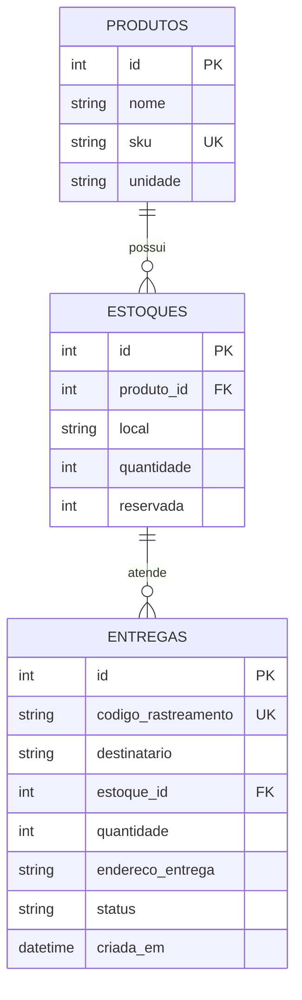

# Modelo de domínio

## Problema

Operadores de centros de distribuição e despachantes precisam saber quanto produto está realmente livre, evitar prometer unidades já reservadas e acompanhar cada entrega até a confirmação no destino.

## Entidades e campos

- **Produto** (`produtos`): `id`, `nome`, `sku` único, `unidade`.
- **Estoque** (`estoques`): `id`, `produto_id`, `local`, `quantidade` física, `reservada`. O saldo disponível é calculado como `quantidade - reservada`.
- **Entrega** (`entregas`): `id`, `codigo_rastreamento` único, `destinatario`, `estoque_id`, `quantidade`, `endereco_entrega`, `status`, `criada_em`.

## Relacionamentos

Um produto pode existir em várias posições de estoque (1:N). Uma posição de estoque pode atender várias entregas (1:N). Cada entrega pertence a uma posição de estoque e reserva o produto nela registrado. As chaves estrangeiras impedem apagar produto/estoque referenciados.

## Diagrama relacional

## Invariantes

`quantidade >= 0`; `0 <= reservada <= quantidade`; quantidade de uma entrega é positiva; criação reserva estoque de forma transacional; saldo livre não pode ser consumido duas vezes. Estados permitidos: `CRIADA → EM_TRANSITO → ENTREGUE`.

## Migração

`alembic/versions/0001_cria_tabelas_logisticas.py` cria as três tabelas, chaves estrangeiras, unicidade do SKU/código de rastreamento e verificações de saldo.
